# whitelee-wind-constraints-qgis
(Write up in progress)

Constraint mapping for onshore wind at Whitelee, south of Glasgow. Used QGIS to identify constraint-free land and calculated summary statistics using PyQGIS. 
## Background
The Scottish Government's ambition for installed capacity of onshore wind in Scotland has been set to at least 20 GW by 2030 (Scottish Government, 2022). This was set out in the Onshore Wind Policy Statement 2022, which also stressed the importance of developments that preserve the natural environment. Locational constraint mapping can be used to address both of these ambitions. 
## Aim
To identify constraint-free land for wind farm development at Whitelee, south of Glasgow.
## Study Area
The study area is centred approximately 22 km south of Glasgow city centre, covering an area of 400 km2 (20 x 20 km). Surrounding towns include Newton Mearns, Kilmarnock and East Kilbride. The grid extent is Easting 246,000 – 266,000 m and Northing 634,000 – 654,000 m (British National Grid, EPSG:27700). 

The area is made up of various landscape types with most of it consisting of moorland (62.59%); the rest is a mixture of farmland, river valleys and some urban areas. These groups were derived from NatureScot's Landscape Character Types (Scottish Natural Heritage, 2019). 
## Methods
Open data was combined in QGIS to create a locational constraint layer to identify constraint-free land. PyQGIS measured the constraint-free areas and obtained summary statistics.  

### 1. Software and coordinate reference system 
- Software: QGIS 3.44.15 and PyQGIS.
- CRS: EPSG:27700 - OSGB36 / British National Grid. Used by these layers: roads, buildings, water, woodland, peat, protected areas (SSSI, SPA, SAC), DTM and all subsequent layers created from them. 
- Basemap: EPSG:3857 WGS 84 / Pseudo-Mercator (used for display purposes).
- Existing turbines: Originally in EPSG:4326 - WGS 84. The turbines were reprojected to EPSG:27700 to match the other layers. 
- British National Grid is the standard grid for Great Britain and the OS and NatureScot data were already supplied in it. 
- A metre-based CRS was essential for creating buffer distances and area calculations. 

### 2. Data Preparation

The table below displays the datasets used and how each was prepared.

| Dataset | Clipped to (tool) | Other preparation |
|---|---|---|
| Study Area | Easting 246,000 - 266,000, Northing 634,000 - 654,000  | Buffered layer to create new 1 km buffer boundary surrounding the study area to avoid edge effects |
| OS OpenMap Local | study area 1 km buffer layer (Clip) |  |
| OS Open Roads | study area 1 km buffer layer (Clip) |  |
| Carbon and Peatland 2016 map | study area 1 km buffer layer (Clip) | Filtered IMPORTANCE field to classes 1 and 2 and 181 features remained |
| SSSIs, SPAs, SACs | study area 1 km buffer layer (Clip) | Layers were merged (Merge tool) as they all followed the same rule of exclusion if present. No SACs, 4 SSSIs and 1 SPA within study area |
| OS Terrain 50 | study area (Clip Raster by Extent) | Nine DTM tiles (NS43-45, NS53-55, NS63-65) were merged. |
| OpenStreetMap Turbines | study area (Clip) | Reprojected to EPSG:27700, then clipped |
| Landscape Character Assessment | study area (Clip) | Added 'Area_km2' and 'LCT_Group' fields |

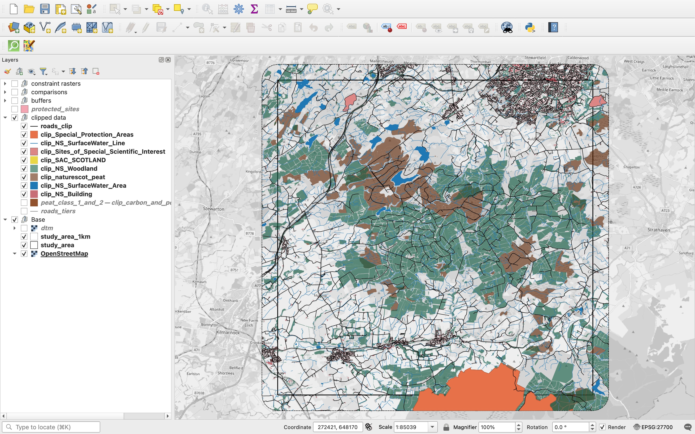

*Screenshot displaying the newly clipped constraint layers alongside the study area, its 1 km buffer and the OSM basemap layers.Data credits: see Data Sources and Licences table.Contains OS data © Crown copyright and database right 2026.Basemap © OpenStreetMap contributors, openstreetmap.org/copyright.*

### 3. Constraint criteria

### 3.1. Turbine Assumptions 
Maximum proposed turbine dimensions were selected from the Whitelee Repowering Scoping Report (ScottishPower Renewables, 2026).
- Hub height: 164 m
- Rotor radius: 86 m 
- Tip height: 250 m

Other assumptions:
- ScottishPower Generation Capacity: 1,000 MW (ScottishPower Renewables, 2026)
- Number of turbines: 124 (ScottishPower Renewables, 2026)
- Minimum Threshold for Major Development: 20 MW (Town and Country Planning, Hierarchy of Developments (Scotland) Regulations, 2009)

These dimensions were chosen to reflect real-world work and decisions made from a real Scoping Report within the study area. The maximum dimensions were chosen as a cautious choice. 

### 3.2. Constraint rules 

| Constraint | Rule | Reason |
|---|---|---|
| Buildings | 500 m buffer | As the Scottish Government's written answer stated that there is no recommended minimum distance between onshore wind turbines and residential properties, I chose a 500 m buffer from Welsh Assembly Government guidance as a separation distance for noise (Scottish Parliament, 2023; Welsh Assembly Government, 2005, Annex D, p. 59).  |
| Woodland | 136 m buffer | Buffer to protect bat populations and reduce the risk of collisions. I created a simplified, precautionary buffer: I used NatureScot's guidance of a 50 m clearance buffer and added this to the rotor radius (50 m plus the 86 m rotor radius, giving 136 m) (NatureScot, 2021; ScottishPower Renewables, 2026) (see Limitations). |
| Roads tier 1: Motorways, trunk, A roads | 375 m buffer | I selected a 375 m buffer based on correspondence from Transport Scotland,  who asked East Lothian Council to require sites to be a minimum of 1.5 x tip height from kerb line of trunk roads; 1.5 x 250 m = 375 m (Transport Scotland, 2013). The letter included this requirement for trunk roads only, which prompted me to make a tiered buffer system for road types. I applied this choice to motorways and A roads as a precautionary simplification, as trunk roads are primarily motorways and major A roads (Traffic Scotland, n.d.).  |
| Roads tier 2: B, minor, local roads, local access and secondary access roads  | 250 m buffer | As I found no Scottish minimum, I based the 250 m buffer choice on Rutland County Council, to account for fall-over distance: tip height (Rutland County Council, 2012).  |
| Roads tier 3: Restricted local access roads | None  | Based on my judgement. Upon inspection of OS Open Roads, these roads were mainly for private use as tracks for Whitelee wind farm within the study area.  |
| Water | 50 m buffer | Cautious choice based on SEPA's recommendation in a scoping consultation for SP Energy Networks, suggesting a 50 m buffer around each watercourse (SP Energy Networks, 2023a). |
| Peat | Importance Classes 1 & 2 | No buffer. Filtered to only include importance classes 1 and 2, regarded as land dominated by rich peat soil and peatland habitats (NatureScot, 2026; Scottish Government, Scottish Natural Heritage, SEPA, 2017). |
| Protected areas | No buffer, SSSI + SPA (no SACs in area) | No buffer; excluded where present, precautionary screen (Scottish Government, 2023). |
| Slope | Steeper than 15°  | No buffer; excluded slopes steeper than 15 degrees, based on Welsh Government guidance (Welsh Assembly Government, 2005, Annex D, p. 58).  |

### 4. Combining the constraints

Each vector layer was rasterised using the 'Rasterize (Vector to Raster)' tool. All rasterised vector layers were set to the same setting to allow them to be combined seamlessly, as set out below: 

- A fixed value to burn: 1. 

- Output extent: Easting 246,000 – 266,000 m and Northing 634,000 – 654,000 m (study area extent). 

- Width and Height resolution: 50 x 50 m.

These values were used to match the OS Terrain 50 dataset, to maintain the alignment of slope values.
  
- NoData value to output bands: -9999.

When rasterising the buildings layer, QGIS had set a NoData value of 0 to output bands, which resulted in only 66% of the area being outputted, as it excluded all area with a value of 0. The project's method relies on cells having a value of 0 or 1, constraint-free or constrained, respectively. Adding the constraints would produce the total number of all constraints present within that cell. If cells were given a NoData value, the raster calculator would have outputted a NoData value. To overcome this, a NoData value of -9999 was set, a value that lies outwith the datasets. This value was applied to the settings of all rasterised vector layers to ensure that every cell with value 0 maintained its value. 

- Output data type: Float32.

Type was chosen in line with all other raster types, to avoid issues when layers are combined. 

- CRS: EPSG:27700 British National Grid.

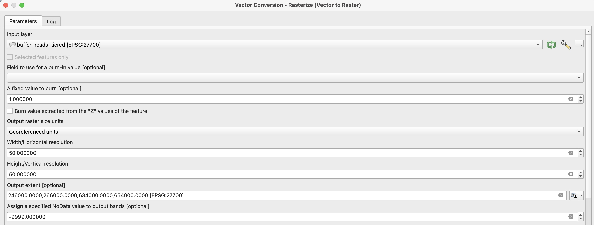

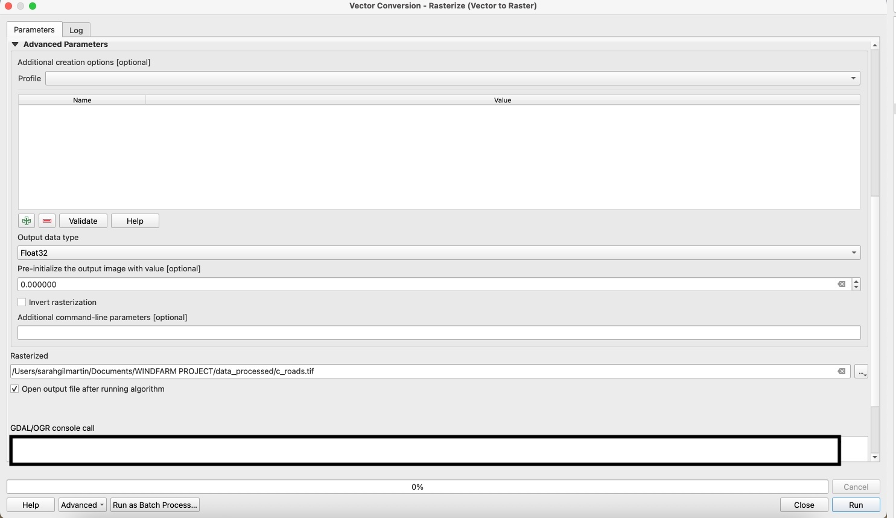

*Screenshot of the 'Rasterize (Vector to Raster)' settings used to convert vector constraint layers into a raster format, in this case, the tiered roads buffer layer.*

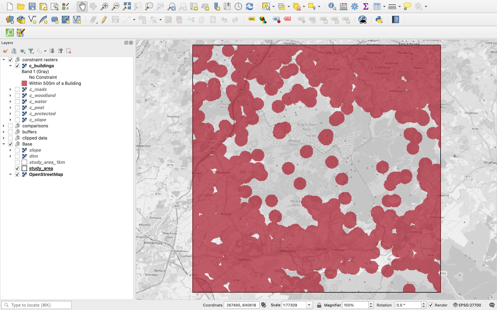

*Screenshot of the buildings constraint raster, showing areas free of this constraint alongside area with 500 m of a building. Contains OS data © Crown copyright and database right 2026. Basemap © OpenStreetMap contributors, openstreetmap.org/copyright.*

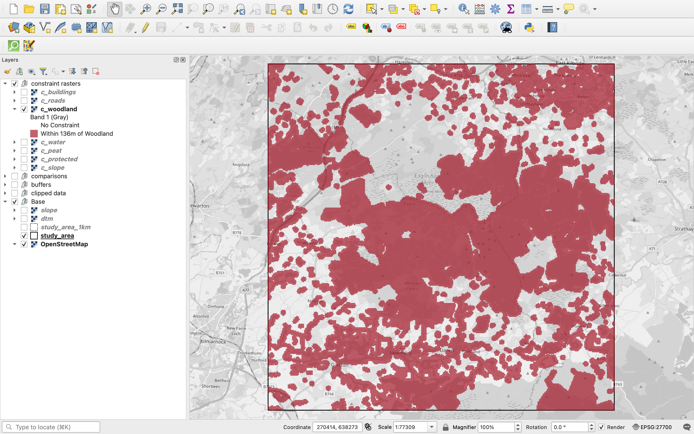

*Screenshot of the woodland constraint raster, showing areas free of this constraint and those within 136 m of woodland. Contains OS data © Crown copyright and database right 2026. Basemap © OpenStreetMap contributors, openstreetmap.org/copyright.*

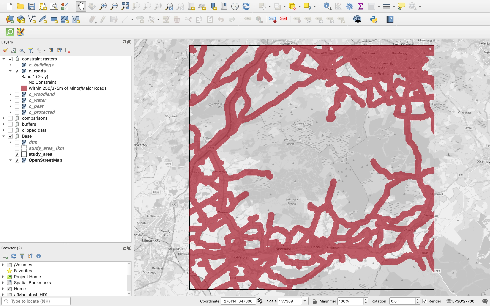

*Screenshot of the roads constraint raster, showing areas free of this constraint alongside areas within 375 m of motorways, trunk and A roads and areas within 250 m of B, minor, local roads, local access and secondary access roads. Contains OS data © Crown copyright and database right 2026. Basemap © OpenStreetMap contributors, openstreetmap.org/copyright.*

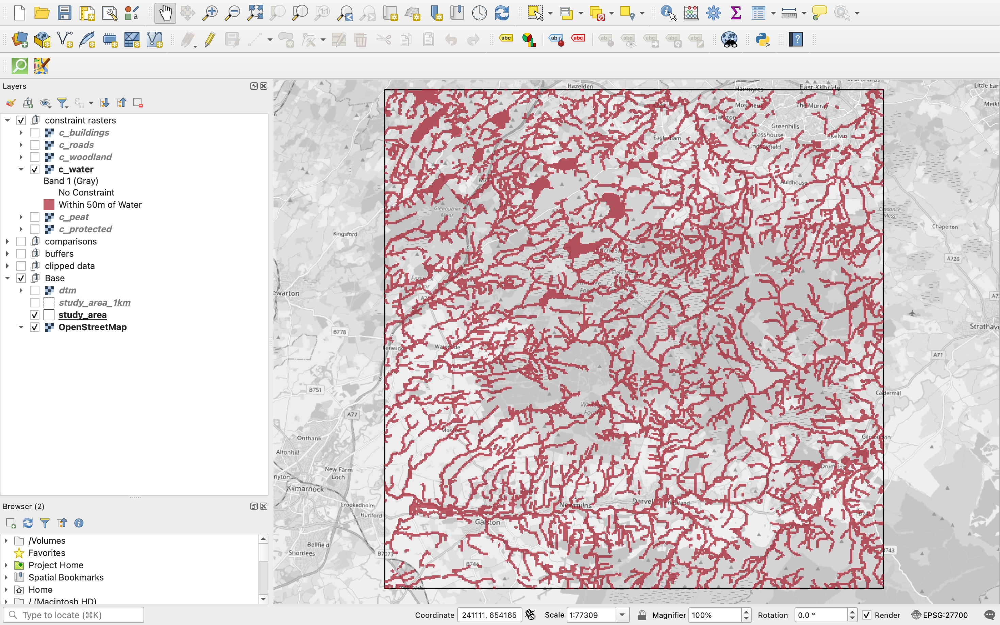

*Screenshot of the surface water constraint raster, displaying areas free of this constraint, and those found within 50 m of a watercourse. Contains OS data © Crown copyright and database right 2026. Basemap © OpenStreetMap contributors, openstreetmap.org/copyright.*

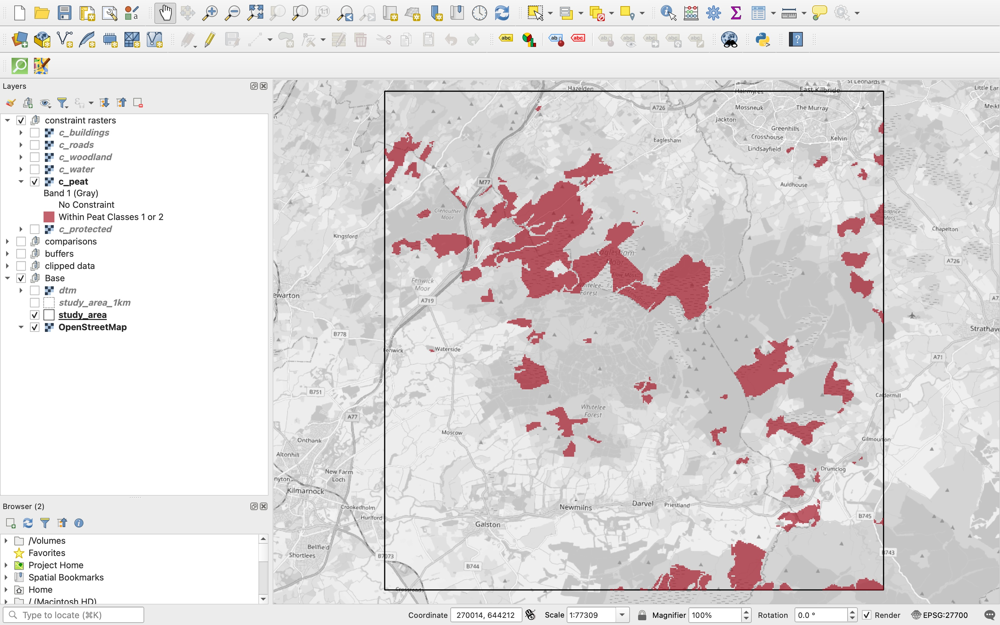

*Screenshot of the peat constraint raster, showing areas free of this constraint alongside those areas containing peat classes 1 or 2. Carbon and Peatland 2016 map, © SNH and JHI. Map produced by SNH using data from the James Hutton Institute, used with permission, all rights reserved. UK Non-Commercial Government Licence v2.0. Basemap © OpenStreetMap contributors, openstreetmap.org/copyright.*

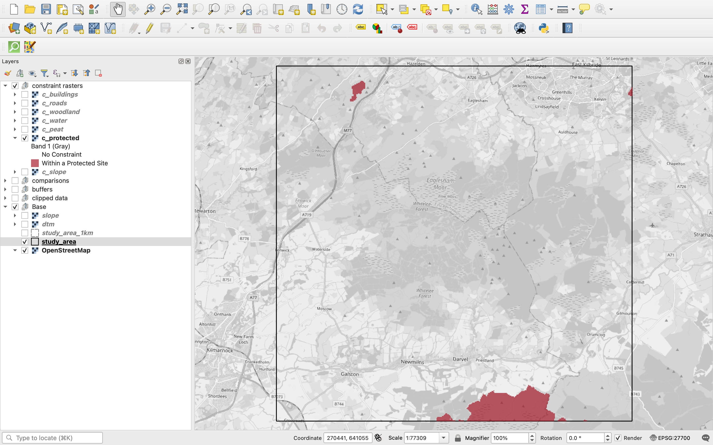

*Screenshot of the protected areas constraint raster, showing those free of protected areas alongside those that contain a protected area. Protected Areas: SSSIs, SPAs, SACs (Copyright Scottish Natural Heritage). Contains OS data © Crown copyright and database right (2022, 2023). Available under the Open Government Licence v3.0. Basemap © OpenStreetMap contributors, openstreetmap.org/copyright.*

Following this, the merged DTM layer was used to obtain slope values using the 'Slope' tool. The Z factor was set to 1 as both the height and horizontal units (EPSG:27700) were in metres. The 'Raster Calculator' tool was used to group slope values: slope values > 15° = 1; slopes ≤ 15° = 0, which was outputted to create a new layer, c_slope. When the new slope layer was compared with the OSM basemap, a small white patch that corresponds to a steep sloped area was identifiable on the slope layer, which correlated with Loudoun Hill on the basemap.  

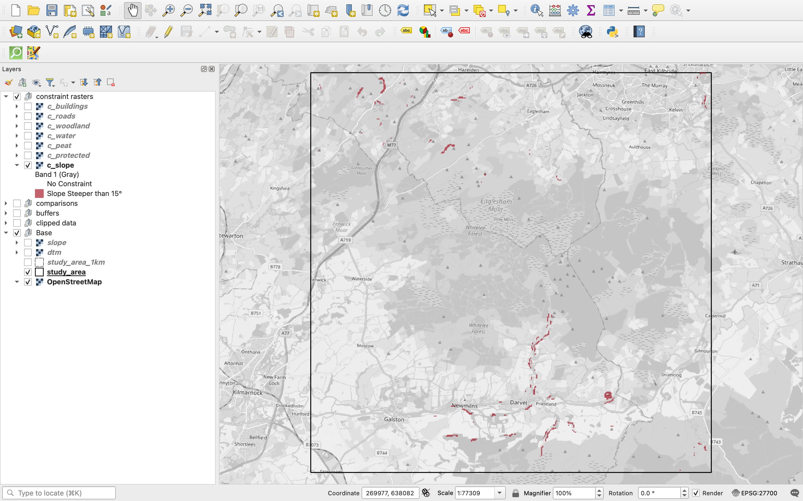

*Screenshot of the slope constraint raster, displaying areas free of this constraint alongside those with slopes steeper than 15°, with Loudoun Hill visibly marked red. Contains OS data © Crown copyright and database right 2026. Basemap © OpenStreetMap contributors, openstreetmap.org/copyright.*

The 'Raster Calculator' tool was used to add all raster layers together, to obtain a raster count for each 50 m cell. The following expression was used:

"c_buildings@1" + "c_peat@1" + "c_protected@1" + "c_roads@1" + "c_slope@1" + "c_water@1" + "c_woodland@1"

Settings: 
- Output extent: set to the study area
- Resolution: 400 columns by 400 rows
- Output CRS: EPSG:27700, British National Grid

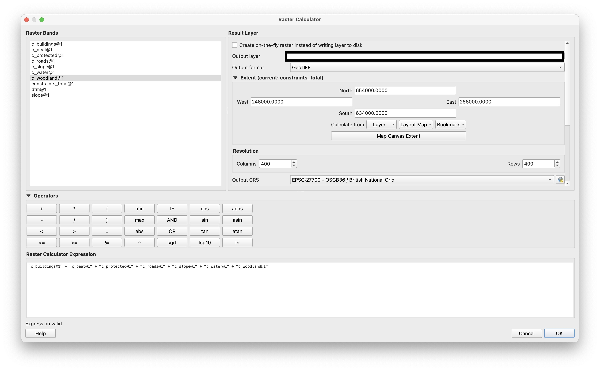

*Screenshot of the 'Raster Calculator' tool used to combine the constraints through raster overlay, displaying the settings including the extent, CRS and the expression.*

The calculator added the number of constraints present for each cell within the study area. The output was saved as a new layer, called constraints_total. To check validity of the data, the sum of all means of the individual constraint layers was matched with the mean of constraints_total. The extent and pixel size were also checked for accuracy. The statistics list produced from constraints_total showed that the layer had 100% valid cells, which demonstrated the NoData value used worked.

A unique values report was produced from constraints_total, which is displayed in the results. The layer symbology was improved for readability by using 'palette/unique values' to display each value with a distinct, identifiable colour. A map was produced using this layer to display the extent of overlapping constraints across the study area.
 
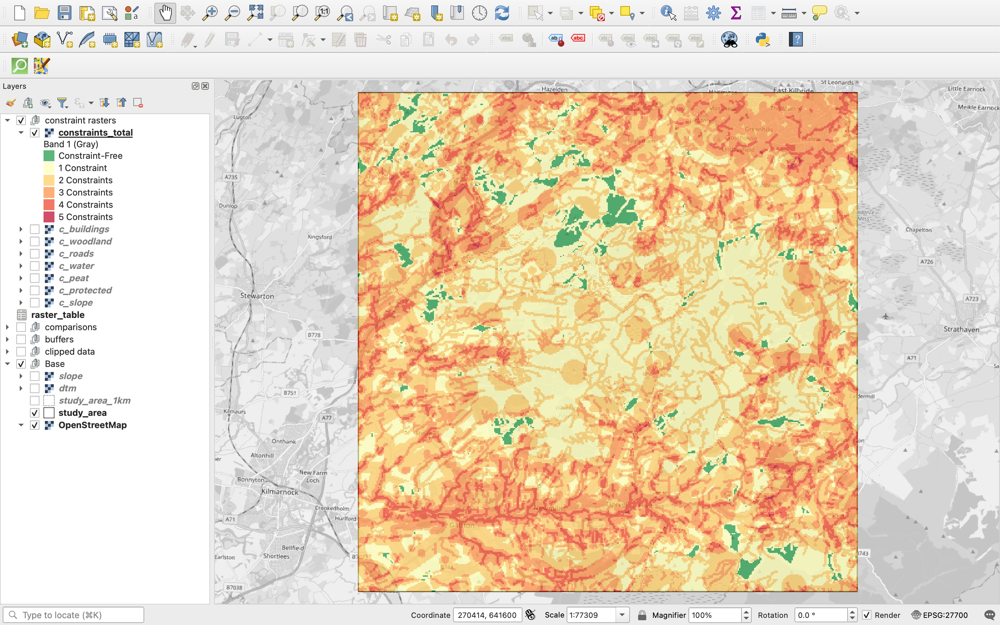

*Screenshot of the combined constraint raster displaying the extent of overlapping constraints across the study area. Data credits: see Data Sources and Licences table. Basemap © OpenStreetMap contributors, openstreetmap.org/copyright.*

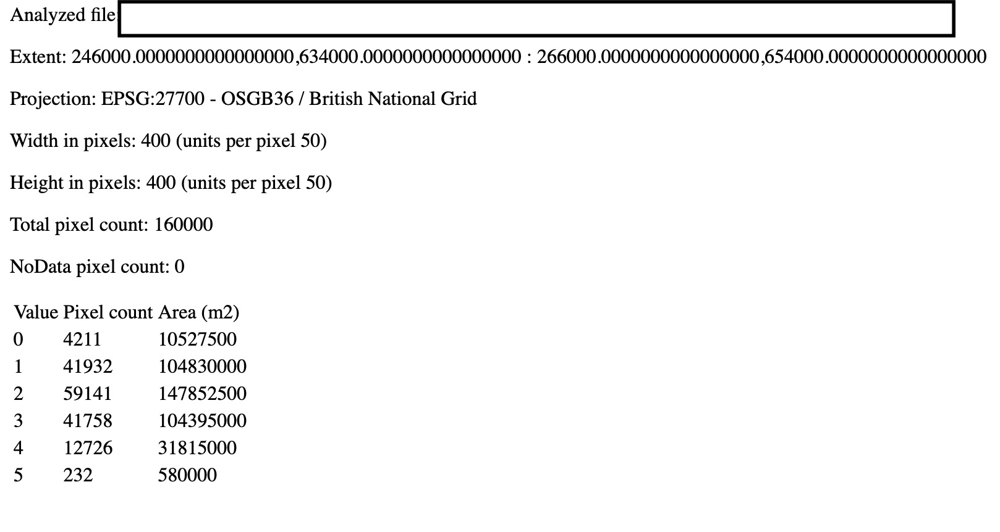

*Screenshot of the unique values report, displaying the total number of pixels with their associated constraint count and area in m2.*

The constraint-free areas were identified using the 'Raster Calculator' tool on the constraints_total layer, with the following expression:

"constraints_total@1" = 0

Cells with a count = 0 (constraint-free) were given a value of 1, whereas cells with a count ≥ 1 (constrained) were given a value of 0. A new layer was created from this, called 'constraint_free.tif' and the statistics were inspected. The mean value of 0.0263 matched the value given in the unique values table, in the results section, where the percentage of the study area covered was 2.63%.

Following this, the layer was converted into polygons using the 'Polygonize' tool.

Settings: 

- Input: 'constraint_free.tif'
- Output: 'constraint_free_areas.gpkg'
- Eight-connectedness: False; 4-connectedness was used, grouping cells that share an edge whilst separating those that meet only at corners. It can also minimise the likelihood of overstating site sizes.
- Field: DN 

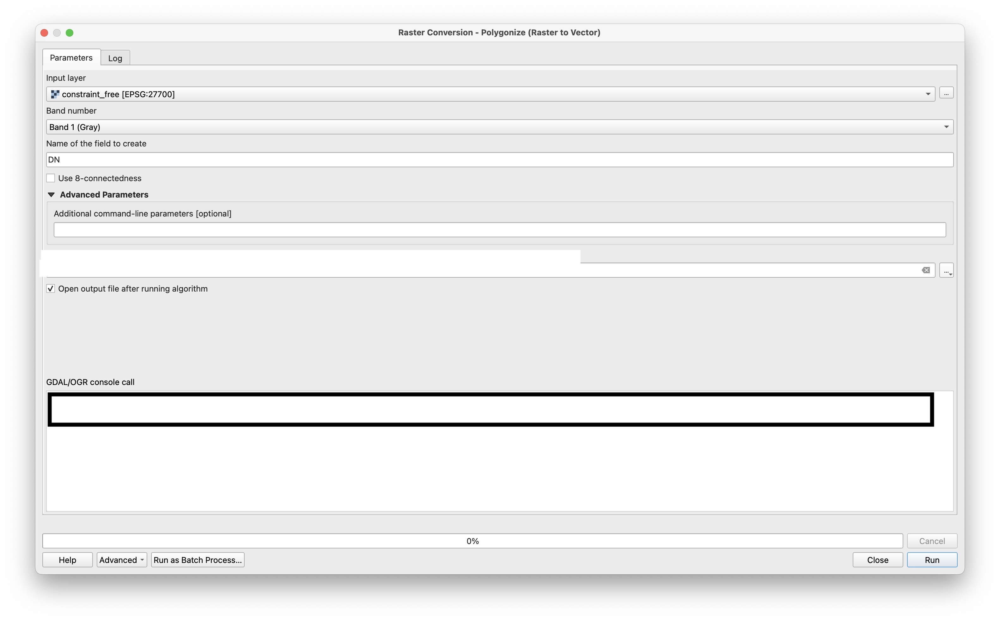

*Screenshot of the 'Polygonize (Raster to Vector)' tool used to convert the constraint_free raster into polygons and the settings used.*

Upon inspection of the attribute table, the new layer comprised 254 features, of which 249 had a DN value of 1 and 5 features had a DN value of 0, which can be interpreted as 249 areas are constraint-free and 5 areas are constrained. Next, a map was produced using this polygon layer to display the constraint-free areas within the study area.  

### 5. Minimum Site Size

The table below shows how the minimum site size was calculated. 

| Parameter | Value | Source
|---|---|---|
| Rotor diameter (m) | 172 | ScottishPower Renewables (2026) |
| Spacing between rows  | 7 rotor diameters (1,204 m) | Gupta (2016, Fig. 5) gives 5 to 9 rotor diameters, of which I chose the midpoint value of the range; 7 x 172 = 1,204 m. |
| Spacing within a row  | 4 rotor diameters (688 m) | Gupta (2016, Fig. 5) gives 3 to 5 rotor diameters, of which I used the midpoint value of the range; 4 x 172 = 688 m. |
| Land per Turbine (km2) | 0.83 | Calculated: (spacing between rows (m) * spacing within a row (m))/1000000 = 0.83|
| Minimum Windfarm Size: Planning Threshold for Major Development (MW) | 20 | Town and Country Planning (Hierarchy of Developments) (Scotland) Regulations (2009) |
| Avg. Capacity per Turbine (MW) | 8.06 | Calculated: 1,000 MW / 124 turbines (ScottishPower Renewables, 2026) |
| No. Turbines per Site (rounded up) | 3 | Calculated: 20 MW threshold / 8.06 MW = 2.48, rounded up to 3 because part of a turbine can't be built and 2 would only give 16 MW. |
| Minimum Site Size (km2; 2dp) | 2.49 | Calculated: Number of turbines per site (rounded) * land per turbine (km2) = 3 * 0.83 km2 = 2.49 km2 |

Values were rounded to 2 decimal places. 

### 6. Site summary statistics

Following this, Python was used to automate summary statistics for the study area, allowing it to be re-run efficiently if anything needed to be changed. The script was run in the Python Console in QGIS (PyQGIS) and two layers were used: the polygonised constraint-free areas layer ('constraint_free_areas') and the clipped OSM turbines layer (turbines_study_area). The script file was saved [site_summary.py](scripts/site_summary.py). 

1. Two fixed values were used, the area of the study area in km2, and the 2.49 km2 minimum site size, which were both stored as 'variables' in the script.
2. The script counted the number of polygons in the 'constraint_free_areas' layer and counted the number of existing turbines in 'turbines_study_area' using their feature count from the 'featureCount()' function in PyQGIS.
3. Ran a 'for loop' and 'if statements' through the polygons in 'constraint_free_areas'. The 'if statement' was used to identify polygons where DN == 1, of which, it quantified the polygon's area in km2 by dividing the area by 1000000, as the layers' units are in metres as the coordinate system was British National Grid. It then added them together for those that met the conditions, of which it ran a second 'if statement', which identified and counted those that had an area of at least 2.49 km2, then ran a third 'if statement' to identify the polygon with the largest area value in km2.
4. Quantified the percentage of the study area that was constraint-free using the total area of those patches where DN == 1 and divided that by the study area in km2, multiplied by 100.
5. Counted the number of existing turbines within constraint-free areas. This was achieved by running a 'for loop' once again, using a 'loop inside a loop', which was run through turbines in the 'turbines_study_area' layer and for polygons in 'constraint_free_areas', and used 'getFeatures()' to go through them one at a time. The conditions of the 'if statements' inside the 'for loop' included those where DN == 1 and those polygons contained a turbine. Each time a turbine was found inside a constraint-free area, the script stored a running total of the number of turbines on constraint-free land, which produced the final value. This number was then divided by the total number of existing turbines within the study area and multiplied by 100 to obtain a percentage. This value was rounded to 2 decimal places. 
6. An 'f-string' was used to print the final values for each output inserted within a statement to improve readability of what those outputs were associated with.

The script output was checked alongside other outputs, with the Python script's output of 2.63% for the percentage of constraint-free area within the study site matching the mean of the constraint-free raster, 0.0263. The number of constraint-free polygons printed from the script, 249, matched the attribute table. The output of the script can be viewed in the 'Results' section below, and the script is viewable in the 'Script' section. 

## Results

Statistics for each constraint raster layer are displayed in the table below.

| Layer | Rule | Min | Max | Valid (%) | Mean | % of study area | km2 (mean x 400) |
|---|---|---|---|---|---|---|---|
| c_buildings | 500 m buffer | 0 | 1 | 100 | 0.6647 | 66.47% | 265.86 |
| c_woodland | 136 m buffer | 0 | 1 | 100 | 0.5935 | 59.35% | 237.42 |
| c_roads | Tiered: 375 / 250 / 0 m | 0 | 1 | 100 | 0.4102 | 41.02% | 164.07 |
| c_water | 50 m buffer | 0 | 1 | 100 | 0.3161 | 31.61% | 126.44 |
| c_peat | Importance Classes 1 & 2 | 0 | 1 | 100 | 0.1020 | 10.20% | 40.78 |
| c_protected | No buffer, SSSI + SPA (no SACs in area) | 0 | 1 | 100 | 0.0200 | 2.00% | 7.98 |
| c_slope | >15 degrees (excluded) | 0 | 1 | 100 | 0.0033 | 0.33% | 1.33 |
| Total |  |  |  |  | 2.1097 | |  |
| Combined Raster Count |  | 0 | 5 | 100 | 2.1097 (SD 0.97) | | |

Next, the number of cells at each score was counted using the Raster layer unique values report. The table below displays the distribution of cells across the number of constraints (0 to 5) per cell.

| Value | Cell count | m2 | km2 | % of study area |
|---|---|---|---|---|
| 0 | 4211 | 10527500 | 10.53 | 2.63% |
| 1 | 41932 | 104830000 | 104.83 | 26.21% |
| 2 | 59141 | 147852500 | 147.85 | 36.96% |
| 3 | 41758 | 104395000 | 104.40 | 26.10% |
| 4 | 12726 | 31815000 | 31.82 | 7.95% |
| 5 | 232 | 580000 | 0.58 | 0.15% |

This suggests the usable land consists of many small patches, in contrast to the unusable land. 

## Maps
1. Interactive web map 1. Extent of locational constraints at Whitelee. Link: https://arcg.is/9LvW02

2. Interactive web map 2. Whitelee constraint-free areas and existing turbines. Link:  https://arcg.is/0HnDqH2

## Limitations
This is a simplified, independent project, not a real planning or site assessment. 

- Woodland buffer: NatureScot recommended a 50 m clearance between blade tip and woodland, using a formula that included hub height, blade length and tree height (NatureScot, 2021). Instead, I measured it horizontally, adding the 50 m to the 86 m rotor radius, excluding hub and tree height. As a result, it is likely that my buffer is larger than the formula would have produced, therefore excluding usable land. This choice was made to keep the project straightforward and approach with caution.
- Surface water buffer: A 50 m water buffer was used, based on recommendations by SEPA for an SP Energy Networks overhead line project (SP Energy Networks, 2023a). However, the project's final design used a 10 m buffer because the number of small watercourses and drains meant that the larger buffer wasn't able to be met, due to spacing requirements between towers (SP Energy Networks, 2023b). Therefore, the 50 m buffer likely excludes more land than a real-world project would use.
- Building buffer: Since OpenMap Local did not give information on building use, all entries were treated equally and given the same buffer. Therefore, land that was usable may have been omitted as a result of the cautious approach. This could be improved by use of data that records building use, to exclude homes without a noise buffer.
- OS Terrain 50 dataset: The dataset will give a more generalised view of the terrain as its designed to work with more small-scale products (Ordnance Survey, 2013). This could result in some areas that are steeper than 15 degrees being identified as meeting the slope threshold. Steep sloped terrain such as Loudoun Hill was identified, however, smaller steep slopes could have been missed. 

## Script

A Python script was created to automate summary statistics for the study area, including the largest site, a 2.49 km2 minimum site size test and existing turbines on constraint-free land.

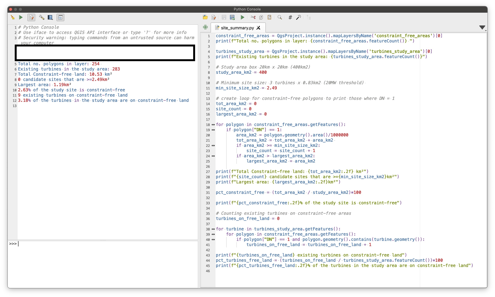

*Screenshot of the Python script and its output in the QGIS Python Console*

## Data Sources and Licences

| Dataset | Provider | Acknowledgement | Licence | Use |
|---|---|---|---|---|
| OS OpenMap Local | Ordnance Survey | Contains OS data © Crown copyright and database right 2026 | OS OpenData | Constraint: buildings, woodlands and surface water |
| OS Open Roads | Ordnance Survey | Contains OS data © Crown copyright and database right 2026 | OS OpenData | Roads constraint |
| Carbon and Peatland 2016 map | NatureScot (SNH) and the James Hutton Institute | Carbon and Peatland 2016 map, © SNH and JHI. Map produced by SNH using data from the James Hutton Institute, used with permission, all rights reserved. UK Non-Commercial Government Licence v2.0. | Non-Commercial Government Licence v2.0 | Peat classes 1 and 2 |
| SSSIs, SPAs, SACs | NatureScot (SNH) | Protected Areas: SSSIs, SPAs, SACs (Copyright Scottish Natural Heritage). Contains OS data © Crown copyright and database right (2022, 2023). Available under the Open Government Licence v3.0. | OGL v3.0 | Protected areas constraint, no SACs fall within study area |
| OS Terrain 50 | Ordnance Survey | Contains OS data © Crown copyright and database right 2026 | OS OpenData | Slope (>15 degrees) |
| OpenStreetMap | OpenStreetMap contributors | © OpenStreetMap contributors, openstreetmap.org/copyright. | ODbL | Existing turbines and basemap |
| Landscape Character Assessment | NatureScot (SNH) | © SNH , contains Ordnance Survey data © Crown copyright and database right (2021) | OGL v3.0 | Landscape types (Study Area description) |

Raw data is not included in the repository and can be downloaded from each provider.
## References

Gupta, N. (2016). 'A review on the inclusion of wind generation in power system studies'. *Renewable and Sustainable Energy Reviews, 59, pp.530-543.* 

Ordnance Survey (2013). OS terrain 50 user guide, version 1.0. Available at: https://digimap.edina.ac.uk/help/files/resource-hub/downloads/osmanuals/os-terrain-50-user-guide_v1.0.pdf (Accessed: 20th November 2026).

NatureScot (2021). Bats and onshore wind turbines: survey assessment and mitigation. Available at: https://www.nature.scot/bats-and-onshore-wind-turbines-survey-assessment-and-mitigation#7.1.2%C2%A0+Buffers-01 (Accessed: 23rd October 2026).

NatureScot (2026). Advising on peatland habitats and carbon-rich soils in development management. Available at: https://www.nature.scot/doc/advising-peatland-habitats-and-carbon-rich-soils-development-management (Accessed: 23rd October 2026).

Rutland County Council (2012). Wind Turbine Developments: Supplementary Planning Document. Oakham: Rutland County Council. Adopted 12/11/2012. Available at: https://www.rutland.gov.uk/sites/default/files/2022-12/Wind%20Turbines%20SPD%20%282012%29.pdf (Accessed: 23rd October 2026).

Scottish Government (2022). *Onshore wind: policy statement 2022*. Available at: https://www.gov.scot/publications/onshore-wind-policy-statement-2022/ (Accessed: 8th November 2026).  

Scottish Government (2023). National Planning Framework 4. Edinburgh: Scottish Government. Available at: https://www.gov.scot/publications/national-planning-framework-4/ (Accessed: 24th October 2026).

Scottish Government, Scottish Natural Heritage, SEPA (2017). Peatland Survey. Guidance on Developments on Peatland, on-line version only. Available at: https://www.gov.scot/binaries/content/documents/govscot/publications/advice-and-guidance/2018/12/peatland-survey-guidance/documents/peatland-survey-guidance-2017/peatland-survey-guidance-2017/govscot%3Adocument/Guidance%2Bon%2Bdevelopments%2Bon%2Bpeatland%2B-%2Bpeatland%2Bsurvey%2B-%2B2017.pdf (Accessed: 24th October 2026). 

Scottish Natural Heritage (2019). *Landscape Character Assessment 2019*. [dataset]. Available at: https://opendata.nature.scot/datasets/18520effe11a4cffa0f22f19a22ac57a_0 (Accessed: 8th November 2026).

Scottish Parliament (2023). Written question and answer S6W-20063, answered 14 August 2023. Available at: https://www.parliament.scot/chamber-and-committees/questions-and-answers/question?ref=S6W-20063 (Accessed: 24th October 2026)

ScottishPower Renewables (2026). Whitelee Windfarm Repowering: Scoping Report. Energy Consents Unit case ECU00006441. Available at: https://www.scottishpowerrenewables.com/documents/d/guest/Whitelee_Windfarm_Repowering_Scoping_Report (Accessed: 23rd October 2026).

SP Energy Networks (2023a). 'Appendix 7.1: Watercourse Crossings and Buffers', in The Glenmuckloch to Glenglass
Reinforcement Project: Environmental Impact Assessment Report, Volume 4. Available at:  https://www.spenergynetworks.co.uk/userfiles/file/Volume_4_Appendix_7.1_Watercourse_Crossings.pdf (Accessed: 24th October 2026). 

SP Energy Networks (2023b). The Glenmuckloch to Glenglass
Reinforcement Project: Environmental Impact Assessment Report: Non-Technical Summary. January 2023. Available at: https://www.spenergynetworks.co.uk/userfiles/file/EIA_Report_Non-Technical_Summary.pdf (Accessed: 23rd October 2026).

Town and Country Planning (2009) Hierarchy of Developments (Scotland) Regulations 2009, SSI 2009/51. Available at: https://www.legislation.gov.uk/ssi/2009/51/schedule/made?view=plain (Accessed: 27th October 2026)

Traffic Scotland (n.d.). Trunk road network. Available at: https://www.traffic.gov.scot/trunk-roads (Accessed: 24th October 2026).

Transport Scotland (2013). Consultation on East Lothian Guidance for wind farms over twelve megawatts [letter to East Lothian Council, 17/05/2013]. Available at: https://eastlothianconsultations.co.uk/housing-environment/12mw_wind_spg/results/response-transport-scotland_redacted.pdf (Accessed: 23rd October 2026).

Welsh Assembly Government (2005). Planning Policy Wales: Technical Advice Note 8: Planning for Renewable Energy. Cardiff: Welsh Assembly Government. Available at: https://www.gov.wales/sites/default/files/publications/2018-09/tan8-renewable-energy_0.pdf  (Accessed: 23rd October 2026).

## AI Use (Fair-Use Statement)
